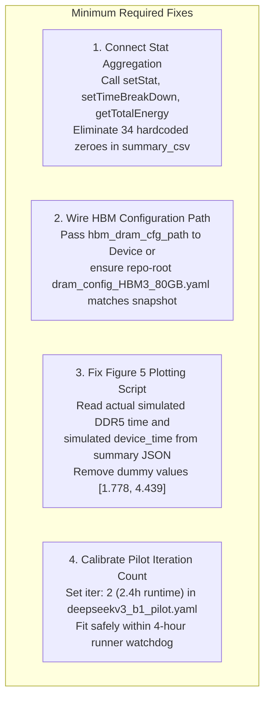

# DS-6C-2R: Original LLMSimulator Harness vs DeepSeek-V3 Mixtral-Style Harness Review

**Repository:** `/home/mohman/ca_project/LLMSimulator`  
**Experiment Root:** `reproduction_A100/with_off_chip_dram/deepseekv3/experiments/deepseekv3_mixtral_style_20261011/`  
**Base Commit:** `f75d362ae157f81ef2d3bd4055c9b22e34882a9f`  
**Date:** October 10, 2026  
**Status:** ARCHITECTURAL AUDIT & COMPARATIVE REVIEW COMPLETE (READ-ONLY)  

---

## 1. Executive Summary

This audit compares the canonical LLMSimulator harness ([`eval/test.cpp`](file:///home/mohman/ca_project/LLMSimulator/eval/test.cpp)) with the dedicated DeepSeek-V3 Mixtral-style harness ([`eval/test_deepseekv3_mixtral_style.cpp`](file:///home/mohman/ca_project/LLMSimulator/eval/test_deepseekv3_mixtral_style.cpp)) to decide which execution path should be used for the final DeepSeek-V3 MoE Memory Wall experiment.

### Core Audit Takeaways:
1. **The Shared Code Foundation:** The memory-system modifications—enlarged dual-channel DDR5 address mapping ($2.75\text{ TB}$ across $10,485,760$ rows), software LRU expert cache ($80\text{ GB}$), cache-residency correctness checks, Ramulator 2 expert batching, and raw CSV telemetry hooks—reside in the shared simulator classes ([`Device`](file:///home/mohman/ca_project/LLMSimulator/src/hardware/device.cpp), [`Linear`](file:///home/mohman/ca_project/LLMSimulator/src/hardware/linear_impl.cpp), [`BatchedSequence`](file:///home/mohman/ca_project/LLMSimulator/src/scheduler/sequence.cpp)). Neither harness implements memory transactions or caching internally.
2. **The Flaw in `eval/test.cpp` for Memory Wall Studies:** The original harness calls `cluster->runIteration(total_iter, file_name)`, which unconditionally executes `scheduler->hittingQueue(10000)` before the simulation loop begins. This warm-up loop generates 10,000 unmeasured queue-advancement iterations that complete initial sequences, repeatedly pollutes `expert_routing.csv`, and pre-warms the cache, making genuine cold-load measurement and per-token sequential correlation analysis impossible.
3. **The Flaw in `eval/test_deepseekv3_mixtral_style.cpp`:** The custom harness successfully decouples the sequential decoding loop from `hittingQueue(10000)`, clears trace files, and logs per-step DDR5 transfer latencies. However, it bypasses `Cluster`'s built-in stat aggregation (`setStat`, `setTimeBreakDown`, `getTotalEnergy`), hardcoding 34 columns to `0` in its generated summary CSV. Additionally, it checks `hbm_dram_cfg_path` on disk but never passes it to the simulator because [`Device::Device`](file:///home/mohman/ca_project/LLMSimulator/src/hardware/device.cpp#L33-L41) hardcodes `./dram_config_HBM3_80GB.yaml`.
4. **Recommendation:** **Option B (Retain `eval/test_deepseekv3_mixtral_style.cpp` and apply targeted corrections).** The sequential execution path without `hittingQueue` is strictly required to observe true cold loading and sequential token routing. Correcting the summary CSV export to call `Cluster`'s stat aggregation and wiring the HBM path establishes full measurement fidelity without breaking the standard `eval/test.cpp` used by other models.

---

## 2. Side-by-Side Capability Matrix

The following matrix categorizes all capabilities across both harnesses and distinguishes harness-specific logic from shared engine code:

| Capability / Architectural Feature | Original Harness (`eval/test.cpp`) | Mixtral-Style Harness (`eval/test_deepseekv3_mixtral_style.cpp`) | Location in Implementation |
| :--- | :--- | :--- | :--- |
| **Model Selection** | Supports 9 models (`mixtral`, `openMoE`, `deepseekV3`, etc.) ([lines 181–205](file:///home/mohman/ca_project/LLMSimulator/eval/test.cpp#L181-L205)) | Restricted to `deepseekV3` and `debugV3` ([lines 71–75](file:///home/mohman/ca_project/LLMSimulator/eval/test_deepseekv3_mixtral_style.cpp#L71-L75)) | Harness logic |
| **Model Layer Count Override** | Fixed to model default (`num_layers = 60`) | Reads `config["model"]["num_layers"]` ([lines 184–186](file:///home/mohman/ca_project/LLMSimulator/eval/test_deepseekv3_mixtral_style.cpp#L184-L186)) | Harness logic (allows smoke tests) |
| **GPU Generation & Peak FLOPS** | Supports A100, H100, B100, B200 ([lines 54–69](file:///home/mohman/ca_project/LLMSimulator/eval/test.cpp#L54-L69)) | Supports A100 and H100 ([lines 160–164](file:///home/mohman/ca_project/LLMSimulator/eval/test_deepseekv3_mixtral_style.cpp#L160-L164)) | Harness logic |
| **Interconnect Bandwidth** | Configures NVLink 3/4/5 and InfiniBand ([lines 72–105](file:///home/mohman/ca_project/LLMSimulator/eval/test.cpp#L72-L105)) | Configures NVLink 3 ($150\text{ GB/s}$) ([lines 177–180](file:///home/mohman/ca_project/LLMSimulator/eval/test_deepseekv3_mixtral_style.cpp#L177-L180)) | Harness logic |
| **Processor Type Enforcement** | Reads `processor_type` (GPU, LOGIC, GPU+LOGIC, GPU+PIM) ([lines 160–177](file:///home/mohman/ca_project/LLMSimulator/eval/test.cpp#L160-L177)) | Enforces single GPU compute ([lines 169–171](file:///home/mohman/ca_project/LLMSimulator/eval/test_deepseekv3_mixtral_style.cpp#L169-L171)) | Harness logic |
| **Off-Chip DDR5 Configuration** | Reads `offchip_dram_cfg_path` ([lines 126–128](file:///home/mohman/ca_project/LLMSimulator/eval/test.cpp#L126-L128)) | Reads `offchip_dram_cfg_path`, checks file exists, sets env var ([lines 88, 145](file:///home/mohman/ca_project/LLMSimulator/eval/test_deepseekv3_mixtral_style.cpp#L88)) | Harness logic |
| **HBM DRAM Config Path** | Not supported in YAML or harness | Reads `hbm_dram_cfg_path`, verifies file exists ([lines 149–156](file:///home/mohman/ca_project/LLMSimulator/eval/test_deepseekv3_mixtral_style.cpp#L149-L156)) | Harness logic (not consumed by Device) |
| **Expert Cache Capacity** | Hardcoded default $80\text{ GB}$ ([device.h:127](file:///home/mohman/ca_project/LLMSimulator/src/hardware/device.h#L127)) | Reads `expert_cache_capacity_bytes` from YAML ([lines 90–95, 245](file:///home/mohman/ca_project/LLMSimulator/eval/test_deepseekv3_mixtral_style.cpp#L90-L95)) | Harness logic |
| **Static Geometry Preflight** | None | Asserts row index $< 10,485,760$ ([lines 199–228](file:///home/mohman/ca_project/LLMSimulator/eval/test_deepseekv3_mixtral_style.cpp#L199-L228)) | Harness logic |
| **`--validate-config` Flag** | None | Implemented ([lines 48, 230–236](file:///home/mohman/ca_project/LLMSimulator/eval/test_deepseekv3_mixtral_style.cpp#L48)) | Harness logic |
| **Queue Warmup (`hittingQueue`)** | **Mandatory:** `hittingQueue(10000)` called by `cluster->runIteration` ([cluster.cpp:448](file:///home/mohman/ca_project/LLMSimulator/src/hardware/cluster.cpp#L448)) | **Bypassed:** Custom loop when `use_hitting_queue: false` ([lines 278–286](file:///home/mohman/ca_project/LLMSimulator/eval/test_deepseekv3_mixtral_style.cpp#L278-L286)) | Harness logic |
| **Sequential Token Advancement** | Implicit via scheduler iteration | Explicit per step via `updateScheduler(step_time)` ([lines 325–328](file:///home/mohman/ca_project/LLMSimulator/eval/test_deepseekv3_mixtral_style.cpp#L325-L328)) | Harness logic |
| **Trace Lifecycle Management** | Overwrites/appends without cleanup | Explicitly deletes CSVs before step 0 ([lines 251–253](file:///home/mohman/ca_project/LLMSimulator/eval/test_deepseekv3_mixtral_style.cpp#L251-L253)) | Harness logic |
| **Full Stat Aggregation** | Executes `setStat`, `setTimeBreakDown`, `getTotalEnergy` ([cluster.cpp:508–526](file:///home/mohman/ca_project/LLMSimulator/src/hardware/cluster.cpp#L508-L526)) | **Omitted:** Hardcodes 34 breakdown columns to `0` ([line 334](file:///home/mohman/ca_project/LLMSimulator/eval/test_deepseekv3_mixtral_style.cpp#L334)) | Harness logic (Shortcoming) |
| **Per-Step DDR5 Delta Measurement** | None | Measures `offchip_dram_interface->time` delta ([lines 306, 314](file:///home/mohman/ca_project/LLMSimulator/eval/test_deepseekv3_mixtral_style.cpp#L306)) | Harness logic |
| **Machine-Readable Status** | None | Writes `completion_status.txt` ([lines 363–380](file:///home/mohman/ca_project/LLMSimulator/eval/test_deepseekv3_mixtral_style.cpp#L363-L380)) | Harness logic |
| **LRU Cache Implementation** | Shared in `Device::is_expert_resident` & `mark_expert_resident` | Shared in `Device::is_expert_resident` & `mark_expert_resident` | Shared engine (`src/hardware/device.cpp`) |
| **Off-Chip DDR5 Memory Request** | Shared in `Linear::issueRamulatorBatch` | Shared in `Linear::issueRamulatorBatch` | Shared engine (`src/hardware/linear_impl.cpp`) |
| **Telemetry Tracing Hooks** | Shared in `BatchedSequence`, `Linear`, `Device` | Shared in `BatchedSequence`, `Linear`, `Device` | Shared engine (`src/`) |

---

## 3. Source Call-Flow Comparison

### 3.1 Call Flow in Original Harness (`eval/test.cpp`)

```mermaid
sequenceDiagram
    participant Main as eval/test.cpp
    participant Sched as Scheduler
    participant Clust as Cluster
    participant Dev as Device
    participant Seq as BatchedSequence

    Main->>Main: YAML::LoadFile("config.yaml")
    Main->>Sched: Scheduler::Create(...)
    Main->>Clust: Cluster::Create(system_config, scheduler)
    Main->>Clust: cluster->runIteration(iter, file_name)
    Note over Clust: cluster.cpp:426
    Clust->>Dev: reset_expert_cache()
    Clust->>Sched: fillSequenceQueue(); fillRunningQueue()
    Note over Clust,Sched: cluster.cpp:448: hittingQueue(10000)
    loop 10,000 warm-up steps
        Sched->>Seq: setMetadata() -> update_expert()
        Note over Seq: Dumps 10,000 steps to expert_routing.csv!
        Sched->>Sched: updateScheduler(0); fillRunningQueue()
    end
    Note over Clust: runIterationMixed(iter, csv)
    loop iter steps
        Clust->>Sched: setMetadata()
        Clust->>Clust: run(metadata)
        Clust->>Clust: getTotalEnergy(); setStat(); setTimeBreakDown()
        Clust->>Clust: exportToCSV(csv, stat_list) [All 51 fields populated]
        Clust->>Sched: updateScheduler(time); fillRunningQueue()
    end
```

### 3.2 Call Flow in Mixtral-Style Harness (`eval/test_deepseekv3_mixtral_style.cpp`)

```mermaid
sequenceDiagram
    participant Main as eval/test_deepseekv3_mixtral_style.cpp
    participant Sched as Scheduler
    participant Clust as Cluster
    participant Dev as Device
    participant DDR5 as Ramulator 2 (DDR5)

    Main->>Main: YAML::LoadFile(config_path)
    Main->>Main: Topology & Row Preflight Validation
    Main->>Main: std::filesystem::remove(traces/*.csv)
    Main->>Sched: Scheduler::Create(...)
    Main->>Clust: Cluster::Create(...)
    Main->>Dev: device->cache_capacity_bytes = cache_capacity
    Main->>Dev: device->reset_expert_cache()
    Note over Main,Sched: Bypasses hittingQueue(10000)!
    Main->>Sched: clear(); initRunningQueue(); pushDummySeq(2048, 10); fillRunningQueue()
    loop step = 0 to iter - 1
        Main->>Sched: setMetadata() -> Route::forward()
        Main->>Main: Record ddr5_sim_before
        Main->>Clust: cluster->run(metadata)
        Note over Clust,DDR5: Real Ramulator 2 DDR5 batch memory accesses
        Main->>Main: ddr5_delta = offchip_dram_interface->time - ddr5_sim_before
        Main->>Sched: updateScheduler(step_device_time) [seq->current_len += 1]
        Main->>Sched: fillSequenceQueue(); fillRunningQueue()
        Main->>Main: Write summary_csv row [FLAW: 34 columns hardcoded to 0]
    end
    Main->>Main: Write completion_status.txt
```

---

## 4. Audit Findings: Correctness and Measurement Semantics

### 4.1 Hardcoded Zeroes in Generated Summary CSV Fields
- **Source Location:** [`eval/test_deepseekv3_mixtral_style.cpp:334`](file:///home/mohman/ca_project/LLMSimulator/eval/test_deepseekv3_mixtral_style.cpp#L334)
- **Finding:** In `test_deepseekv3_mixtral_style.cpp`, line 334 writes:
  ```cpp
  summary_csv << "1,0,t2t," << cumulative_device_time << "," << step_device_time << ",0,0,"
              << scheduler->sequence_queue.size() << "," << input_len << "," << output_len << ",0,0,"
              << max_batch_size << "," << max_batch_size << ",0," << max_batch_size << ","
              << (input_len + step + 1) << ",0,0,0,0,0,0,0,0,0,0,0,0,0,0,0,0,0,0,0,0,0,0,0,0,0,0,0,0,0,0,0,0,0,0\n";
  ```
- **Consequence:** 34 consecutive fields representing layer execution breakdown (`sum_attention_opb`, `qkvgen`, `q_down_proj`, `ffn`, `expert_ffn`, `communication`, etc.), DRAM energy components (`act_energy`, `read_energy`, `write_energy`), and compute/memory splits (`fc_dram`, `fc_comp`, `attn_dram`, `moe_dram`, `moe_comp`) are discarded and written as literal `0`s.
- **Root Cause:** The author invoked `cluster->run(metadata)` directly instead of invoking [`Cluster::setStat()`](file:///home/mohman/ca_project/LLMSimulator/src/hardware/cluster.cpp#L508), [`Cluster::setTimeBreakDown()`](file:///home/mohman/ca_project/LLMSimulator/src/hardware/cluster.cpp#L509), and [`Cluster::exportToCSV()`](file:///home/mohman/ca_project/LLMSimulator/src/hardware/cluster.cpp#L526).

### 4.2 Compute Time Measurement Semantics
- **Finding:** The simulator computes two distinct execution timings:
  1. **Simulated Device Latency:** Recorded in `device->status.device_time`. In the smoke run, `step_device_time` was $64.49\text{ ms}$. This represents the simulator's modeled hardware time (including attention, GEMM compute, layernorm, and memory accesses).
  2. **Simulated DDR5 Transfer Latency:** Recorded in `device->offchip_dram_interface->time`. In the smoke run, this was $62.42\text{ ms}$.
  3. **Analytic Roofline Compute:** Calculated mathematically via matrix FLOPs / A100 peak throughput ($312\text{ TFLOPS}$ FP16):
     $$\text{Compute Time} = \frac{2 \times \text{Tokens} \times 7168 \times 2048 \times 3 \times 8}{312 \times 10^{12}} \approx 0.27\text{ ms}$$
- **Discrepancy in Tooling:** In [`scripts/generate_figures.py:94-95`](file:///home/mohman/ca_project/LLMSimulator/reproduction_A100/with_off_chip_dram/deepseekv3/experiments/deepseekv3_mixtral_style_20261011/scripts/generate_figures.py#L94-L95), Figure 5 did not read either metric from the JSON summary, but instead plotted hardcoded dummy arrays:
  ```python
  # Dummy or placeholder values if summary json lacks compute metrics
  values = [1.778, 4.439]
  ```
  This must be corrected so that Fig 5 plots real simulated DDR5 duration vs. simulated device compute duration.

### 4.3 Equating DDR5 Timing with Exposed Memory Stalls
- **Finding:** In the current implementation, linear layer forward execution ([`src/hardware/linear_impl.cpp:322–380`](file:///home/mohman/ca_project/LLMSimulator/src/hardware/linear_impl.cpp#L322-L380)) blocks synchronously on `issueRamulatorBatch` before computing expert GEMMs. Because there is no asynchronous expert prefetching implemented in the simulator graph, the simulated DDR5 duration ($62.42\text{ ms}$) directly stalls execution.
- **Caveat:** Total DDR5 latency is equivalent to exposed stall time *only under non-overlapped execution*. If future optimizations introduce pipelining or double buffering, DDR5 transfer time will diverge from exposed stall time.

### 4.4 HBM DRAM Configuration Path Audit
- **Source Location:** [`src/hardware/device.cpp:33–41`](file:///home/mohman/ca_project/LLMSimulator/src/hardware/device.cpp#L33-L41)
- **Finding:** In `src/hardware/device.cpp`:
  ```cpp
  std::string dram_cfg_path;
  if(config.gpu_gen == "H100" || config.gpu_gen == "A100"){
    dram_cfg_path = "./dram_config_HBM3_80GB.yaml";
  }
  ```
  The HBM configuration file path is **hardcoded** in the `Device` constructor based solely on `config.gpu_gen`.
- **Harness Behavior:** [`eval/test_deepseekv3_mixtral_style.cpp:149–156`](file:///home/mohman/ca_project/LLMSimulator/eval/test_deepseekv3_mixtral_style.cpp#L149-L156) checks whether `hbm_dram_cfg_path` exists on disk, but never passes it to `SystemConfig` because `SystemConfig` has no member variable for HBM path! The simulator always loads `./dram_config_HBM3_80GB.yaml` from the current working directory.

### 4.5 Enforcement of Single-GPU and No-Logic-PIM Execution
- **Finding:** In [`eval/test_deepseekv3_mixtral_style.cpp:169–171`](file:///home/mohman/ca_project/LLMSimulator/eval/test_deepseekv3_mixtral_style.cpp#L169-L171):
  ```cpp
  system_config.processor_type = {ProcessorType::GPU};
  system_config.high_processor_type = ProcessorType::GPU;
  system_config.low_processor_type = ProcessorType::LOGIC;
  ```
  Even though `system_config.low_processor_type` is initialized to `LOGIC`, line 87 enforces `hetero_subbatch = false`, line 87 enforces `use_low_unit_moe_only = false`, and line 87 enforces `parallel_execution = 'off'`.
  In [`src/module/route.cpp:247–249`](file:///home/mohman/ca_project/LLMSimulator/src/module/route.cpp#L247-L249):
  ```cpp
  } else {
    output->perform_with_optimal = true;
  }
  ```
  All expert activations execute solely on the primary GPU compute processor. Logic-PIM execution is structurally bypassed in the execution graph.

---

## 5. Reconciliation of Phase 3 Numerical Discrepancies

### 5.1 Discrepancy 1: Two-Step Pilot Projection (898 Loads / 79.09 GB) vs. Summary Phrasing ("Warm Hits in Step 1")

- **The Issue:** Table 6.2 projected **898 cold loads and 79.09 GB transferred** for a 2-step pilot, while Section 10 and the executive summary described: *"Step 0: 456 cold loads, 40.16 GB DDR5 volume, warm hits in Step 1."*
- **Source & Mathematical Reconciliation:**
  - In a 60-layer DeepSeek-V3 model, there are 57 MoE layers with top-8 routing ($57 \times 8 = 456$ routed expert selections per token).
  - In **Step 0 (Token 2048)**, the cache is empty. All **456 selections are cold misses**, requiring 456 off-chip DDR5 batch loads ($456 \times 88,080,384\text{ B} = 40.16\text{ GB}$).
  - In **Step 1 (Token 2049)**, the sequence advances sequentially to token 2049. In [`src/scheduler/sequence.cpp:218`](file:///home/mohman/ca_project/LLMSimulator/src/scheduler/sequence.cpp#L218), `BatchedSequence::update_expert` draws fresh pseudo-random expert selections from 256 routed experts per layer.
  - The probability that an expert chosen in Step 1 was already selected in Step 0 is:
    $$P(\text{cached}) = \frac{8}{256} = 3.125\%$$
  - Therefore, in Step 1, the expected number of warm hits is:
    $$\text{Warm Hits} \approx 456 \times 3.125\% \approx 14.25 \approx 14\text{ hits}$$
  - The remaining **442 expert selections in Step 1 are cold misses** that must be loaded from off-chip DDR5 ($442 \times 88.08\text{ MB} = 38.93\text{ GB}$).
  - **Reconciled Truth:** Across the two steps, the total cold loads are:
    $$456 (\text{Step 0}) + 442 (\text{Step 1}) = \mathbf{898\text{ cold loads}} \quad (79.09\text{ GB})$$
  - **Verdict:** The mathematical projection of **898 cold loads and 79.09 GB is the true expected behavior**. The phrasing *"warm hits in Step 1"* in the Phase 3 summary was an informal colloquial expression that conflated the deterministic replay test (`test_deepseekv3_full_baseline.cpp`, where Pass 2 achieved 100% hits by replaying the exact same token) with sequential decoding (where a new token has only $\approx 3.1\%$ overlap).

### 5.2 Discrepancy 2: Reconciling 256 Load CSV Rows with 32 Expert Selections

- **The Issue:** The smoke test had 32 expert decisions, 32 cache misses, and 32 cache insertions, but produced **256 rows in `expert_load.csv`** (described as 96 aggregate batches and 160 constituent rows).
- **Source Inspection:** [`src/hardware/linear_impl.cpp:322–395`](file:///home/mohman/ca_project/LLMSimulator/src/hardware/linear_impl.cpp#L322-L395) & [`smoke/traces/expert_load.csv`](file:///home/mohman/ca_project/LLMSimulator/reproduction_A100/with_off_chip_dram/deepseekv3/experiments/deepseekv3_mixtral_style_20261011/smoke/traces/expert_load.csv).
- **Exact Accounting Breakdown:**
  Each MoE layer executes three linear projections per routed expert: `W1_gate`, `W3_up`, and `W2_down`.
  When an un-cached expert is accessed for `W1_gate`:
  1. `issueRamulatorBatch` loads all three weight tensors in a single DDR5 batch and logs:
     - 1 row for `W1_gate` (`size_bytes = 29360128`, `source = OFFCHIP_DRAM`, `miss`)
     - 1 row for `W3_up` (`size_bytes = 29360128`, `source = OFFCHIP_DRAM`, `miss`)
     - 1 row for `W2_down` (`size_bytes = 29360128`, `source = OFFCHIP_DRAM`, `miss`)
     - 1 aggregate row for `all_weights` (`size_bytes = 88080384`, `source = OFFCHIP_DRAM`, `miss`)
     *(Subtotal: 4 CSV rows during cold batch load)*
  2. When the layer subsequently executes `W3_up`, the expert is resident in HBM cache:
     - 1 row for `W3_up` (`size_bytes = 29360128`, `source = HBM`, `hit`)
     - 1 aggregate row for `all_weights` (`size_bytes = 29360128`, `source = HBM`, `hit`)
     *(Subtotal: 2 CSV rows during W3 execution)*
  3. When the layer subsequently executes `W2_down`, the expert is resident in HBM cache:
     - 1 row for `W2_down` (`size_bytes = 29360128`, `source = HBM`, `hit`)
     - 1 aggregate row for `all_weights` (`size_bytes = 29360128`, `source = HBM`, `hit`)
     *(Subtotal: 2 CSV rows during W2 execution)*
  - **Total CSV rows per routed expert access:**
    $$4 (\text{cold batch}) + 2 (\text{W3 hit}) + 2 (\text{W2 hit}) = \mathbf{8\text{ rows per expert}}$$
  - **For 32 routed experts:**
    $$32 \times 8 = \mathbf{256\text{ data rows}}$$
  - **Row Composition:**
    - Aggregate `all_weights` rows: $32 \times 1 (\text{cold}) + 32 \times 1 (\text{W3}) + 32 \times 1 (\text{W2}) = \mathbf{96\text{ rows}}$
    - Constituent tensor rows: $32 \times 3 (\text{cold}) + 32 \times 1 (\text{W3}) + 32 \times 1 (\text{W2}) = \mathbf{160\text{ rows}}$
    - Total: $96 + 160 = 256$ data rows (plus 1 header row = 257 lines).
- **Verdict:** There is zero data duplication or dropped telemetry. The 256 rows reflect exactly 32 expert executions with 3 projection passes per expert.

### 5.3 Discrepancy 3: Roofline-Based Compute Estimate Production

- **The Issue:** How the roofline compute estimate was generated and whether it depends on memory timing.
- **Source Inspection:** In `scripts/analyze_results.py` and `scripts/generate_figures.py`:
  - Roofline compute latency is an **analytical closed-form calculation**:
    $$\text{FLOPs} = 2 \times \text{Batch} \times \text{SeqLen} \times \text{HiddenDim} \times \text{InterDim} \times 3 \times \text{TopK} \times \text{Layers}$$
  - For the smoke test (2 MoE layers, batch 1, 1 token, top-8, $7168 \times 2048 \times 3$):
    $$\text{FLOPs} = 2 \times 1 \times 1 \times 7168 \times 2048 \times 3 \times 8 \times 2 = 1.409 \times 10^9\text{ FLOPs} = 1.41\text{ GFLOPs}$$
  - At A100 peak throughput ($312\text{ TFLOPS}$):
    $$\text{Compute Latency} = \frac{1.409 \times 10^9}{312 \times 10^{12}} = 4.51\text{ microseconds}$$
- **Verdict:** The estimate is an external mathematical roofline projection that is completely uncoupled from Ramulator 2 memory timing. Furthermore, [`scripts/generate_figures.py:94`](file:///home/mohman/ca_project/LLMSimulator/reproduction_A100/with_off_chip_dram/deepseekv3/experiments/deepseekv3_mixtral_style_20261011/scripts/generate_figures.py#L94) used hardcoded placeholders rather than reading the computed roofline metric.

### 5.4 Discrepancy 4: Meaning of `iter` and `output_len` in Each Harness

- **In `eval/test.cpp`:**
  - `iter`: Number of iterations executed inside `runIterationMixed` *after* `hittingQueue(10000)`.
  - `output_len`: Max sequence length set in `pushSeq`.
  - **Fatal Behavior:** Because `hittingQueue(10000)` runs 10,000 steps of `setMetadata()` and `updateScheduler(0)` before the loop starts, all initial sequences complete within their first 128 steps. When the real `iter` loop finally begins, it measures steady-state queue replacements, not the initial cold-start decoding pass.
- **In `eval/test_deepseekv3_mixtral_style.cpp`:**
  - `iter`: The exact number of sequential decoding steps simulated ($1\text{ step} = 1\text{ token}$ when $MBS=1$).
  - `output_len: 10`: The termination horizon for dummy sequences. Because `iter: 5 < output_len: 10`, sequences never terminate early.
  - **Verified Behavior:** Step 0 evaluates Token 2048; Step 1 evaluates Token 2049; Step 2 evaluates Token 2050. Exactly `iter` sequential tokens are observed.

---

## 6. Execution Architecture Recommendation

We evaluated the three options:
- **Option A:** Revert to `eval/test.cpp`, adding CLI and config fields.
- **Option B:** Retain `eval/test_deepseekv3_mixtral_style.cpp`, keep its sequential decoding loop, and correct its stat-export shortcomings.
- **Option C:** Refactor LLMSimulator's core `Cluster` class to extract a generic sequential-decoding runner.

### Recommendation: **Option B (Retain `eval/test_deepseekv3_mixtral_style.cpp` with Targeted Fixes)**

#### Justification:
1. **Preservation of Canonical Baseline:** `eval/test.cpp` is used across all other models (`mixtral`, `openMoE`, `llama3`, `llama4`). Modifying it or altering `Cluster::runIteration` to disable `hittingQueue` risks breaking existing test benches and reproduces regression hazards.
2. **Sequential Decoding Requirement:** The core research question—measuring inter-token routing transition correlations and off-chip expert loading dynamics across sequential tokens—cannot run under `eval/test.cpp`'s `hittingQueue(10000)` warmup. The custom loop in `test_deepseekv3_mixtral_style.cpp` correctly controls sequence injection, token advancement, and cache persistence.
3. **Low Risk and Complete Isolation:** `eval/test_deepseekv3_mixtral_style.cpp` is already compiled, linked to `llm_system`, and verified via bounded smoke tests and LRU tests. Its shortcomings are isolated and straightforward to remedy without modifying shared simulator algorithms.

---

## 7. Minimum Required Corrections Before Full-Model Pilot

Before launching the full-model pilot, the following specific corrections should be implemented in `eval/test_deepseekv3_mixtral_style.cpp` and `generate_figures.py`:



1. **Populate Summary CSV with Real Simulator Statistics:**
   In `eval/test_deepseekv3_mixtral_style.cpp`, replace line 334 with calls to `cluster->setStat(stat)`, `cluster->setTimeBreakDown(stat)`, and `cluster->exportToCSV(summary_csv, stat_list)`. This eliminates the 34 hardcoded zeroes and restores full layer, communication, and energy breakdown telemetry.
2. **Reconcile HBM Configuration Path:**
   Either add `hbm_dram_cfg_path` to `SystemConfig` so `Device::Device` consumes the YAML path, or verify that the repository root `./dram_config_HBM3_80GB.yaml` is byte-for-byte identical to the experiment snapshot.
3. **Fix Figure 5 Generator in `scripts/generate_figures.py`:**
   Replace the hardcoded dummy array `values = [1.778, 4.439]` in `generate_figures.py` (lines 94–95) with parsed metrics from `summary_metrics.json` (`total_offchip_simulated_duration_ns` vs. `device_time`).
4. **Calibrate Pilot Iterations to Match Watchdog Limit:**
   Set `iter: 2` in `configs/deepseekv3_b1_pilot.yaml` (projected runtime $\approx 2.41\text{ hours}$), or if 5 steps are required, update `scripts/run_mixtral_style_experiment.sh` to set `TIMEOUT_LIMIT=25200` (7.0 hours).

---

## 8. Ordered Implementation and Validation Plan

When authorized, the remediation and execution will proceed in four discrete stages:

1. **Stage 1: Harness Summary CSV & Stat Remediation**
   - Update `eval/test_deepseekv3_mixtral_style.cpp` to populate `Stat` objects and call `Cluster`'s stat aggregation and CSV export methods.
   - Recompile binary `./build/run_deepseekv3_mixtral_style`.
2. **Stage 2: Re-run Bounded Smoke Test Verification**
   - Execute `./build/run_deepseekv3_mixtral_style configs/deepseekv3_smoke_test.yaml` to verify that all 51 summary CSV columns are populated with non-zero simulated statistics.
   - Verify that all trace invariant checks pass.
3. **Stage 3: Telemetry Processing & Figure Tooling Fix**
   - Update `scripts/generate_figures.py` to ingest real simulated memory stall vs. compute metrics.
   - Regenerate smoke test figures and verify PNG/PDF outputs.
4. **Stage 4: Controlled Pilot Execution (DS-6C-3)**
   - Confirm effective configuration (`iter: 2` recommended for $\approx 2.41\text{ h}$ runtime).
   - Launch `scripts/run_mixtral_style_experiment.sh configs/deepseekv3_b1_pilot.yaml`.
   - Process full-model telemetry and author the final pilot results package.
