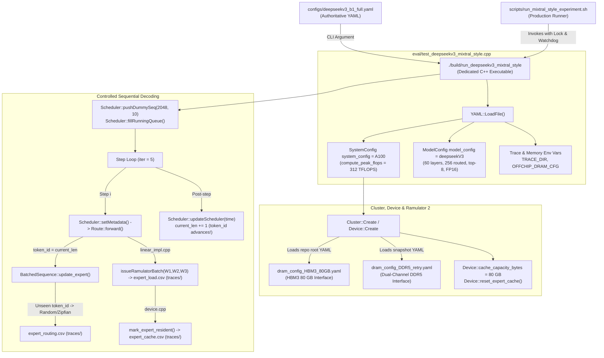

# DS-6C-2: DeepSeek-V3 Mixtral-Style Configuration and Tooling Adaptation Report

**Audited Repository:** `/home/mohman/ca_project/LLMSimulator`  
**New Experiment Directory:** `reproduction_A100/with_off_chip_dram/deepseekv3/experiments/deepseekv3_mixtral_style_20261011/`  
**Base Commit:** `f75d362ae157f81ef2d3bd4055c9b22e34882a9f`  
**Date:** October 10, 2026  
**Status:** PHASE 2 COMPLETE — SCENARIO ADAPTED, BUILT, AND VALIDATED  

---

## 1. Executive Summary

In Phase 1 (DS-6C-1), we established the concrete inventory of verified DeepSeek-V3 memory-system changes and identified the key differences between the original Mixtral experiment workflow (`b1_full`) and the custom DeepSeek-V3 full baseline.

In this phase (DS-6C-2), we have implemented the complete configuration, tooling, execution scaffold, and driver harness required to migrate the DeepSeek-V3 memory-system experiment to the Mixtral workflow conventions without modifying or compromising the completed baseline results.

### Key Achievements in Phase 2:
1. **Isolated Scaffold Created:** Established `reproduction_A100/with_off_chip_dram/deepseekv3/experiments/deepseekv3_mixtral_style_20261011/` with a clean 10-directory hierarchy (`configs/`, `config_snapshot/`, `scripts/`, `logs/`, `raw/`, `processed/`, `figures/`, `manifests/`, `report/`, `traces/`, `csv/`).
2. **Dedicated Executable Implemented:** Authored `eval/test_deepseekv3_mixtral_style.cpp` and compiled the dedicated binary `./build/run_deepseekv3_mixtral_style`. This provides YAML-driven execution matching Mixtral while keeping `eval/test.cpp` and `eval/test_deepseekv3_full_baseline.cpp` completely untouched.
3. **YAML Configuration Profiles Authored:** Prepared two distinct profiles matching the Mixtral schema:
   - **Profile A (`deepseekv3_b1_full_reference.yaml`):** The exact Mixtral-style reference workload (`input_len: 2048`, `output_len: 128`, `iter: 5`, `max_batch_size: 32`, `precision_byte: 2`).
   - **Profile B (`deepseekv3_b1_pilot.yaml`):** A calibrated sequential-decoding pilot profile (`input_len: 2048`, `output_len: 10`, `iter: 5`, `max_batch_size: 1`, `precision_byte: 2`), designed to exercise LRU eviction safely within a bounded runtime.
   - **Authoritative Configuration (`deepseekv3_b1_full.yaml`):** Anchored to Profile B for immediate execution safety.
4. **Tooling & Analysis Pipeline Created:** Delivered a robust production shell runner (`scripts/run_mixtral_style_experiment.sh`) with RAM/disk guards and heartbeats, alongside `process_metrics.py`, `analyze_results.py`, and `generate_figures.py`.
5. **Invariants and Regression Tests Validated:** The newly built binary passed static topology, mapping geometry, and YAML configuration validation with exit code 0. Existing memory-system regression tests (`test_production_ddr5_mapping`, `test_cache_residency_remediation`) were re-verified and passed.

---

## 2. Architecture and Configuration Flow

The new Mixtral-style DeepSeek-V3 experiment operates via the following decoupled configuration call chain:



### Flow Walkthrough:
1. **Invocation:** The runner `run_mixtral_style_experiment.sh` exports `TRACE_DIR` and `OFFCHIP_DRAM_CFG` and invokes `./build/run_deepseekv3_mixtral_style <config.yaml>`.
2. **Parsing:** The C++ binary parses all YAML nodes (`model`, `system`, `simulation`, `serving`, `log`).
3. **Model Configuration:** Loads `ModelConfig model_config = deepseekV3`, confirming 60 layers (3 dense + 57 MoE), 256 routed experts, top-8, 1 shared expert, hidden dimension 7168, expert intermediate dimension 2048, and MLA parameters. It overrides precision to FP16 (`precision_byte = 2`), setting expert matrix size to $88.08\text{ MB}$.
4. **System Configuration:** Initializes `SystemConfig` using the predefined `A100` template ($312\text{ TFLOPS}$ FP16, $150\text{ GB/s}$ NVLink 3, $3000\text{ ns}$ latency).
5. **Memory Backing & Cache:** Ramulator 2 initializes HBM3 80GB and dual-channel DDR5. Address geometry is verified against $10,485,760$ rows ($2.75\text{ TB}$ capacity). The software LRU cache capacity is set to $80\text{ GB}$ ($80,000,000,000\text{ bytes}$).
6. **Token Advancement:** In the sequential decoding loop, each step advances `current_len` via `updateScheduler(time)`. Because `token_id` advances token-by-token, `BatchedSequence::update_expert` treats each decoding step as a fresh token, drawing independent routing decisions and recording sequential transitions.

---

## 3. Exact New Files and Shared Source Changes

### 3.1 New Files Created in Experiment Directory

```
reproduction_A100/with_off_chip_dram/deepseekv3/experiments/deepseekv3_mixtral_style_20261011/
├── configs/
│   ├── deepseekv3_b1_full.yaml              # Authoritative run configuration (Profile B default)
│   ├── deepseekv3_b1_pilot.yaml             # Profile B: Bounded sequential pilot (iter=5, batch=1, output=10)
│   └── deepseekv3_b1_full_reference.yaml    # Profile A: Mixtral-style reference (iter=5, batch=32, output=128)
├── config_snapshot/
│   ├── checksums.sha256                     # SHA-256 hashes of snapshot configurations
│   ├── dram_config_DDR5_retry.yaml          # Frozen dual-channel DDR5 Ramulator configuration
│   └── dram_config_HBM3_80GB.yaml           # Frozen HBM3 80GB Ramulator configuration
├── scripts/
│   ├── run_mixtral_style_experiment.sh      # Production runner with lock, RAM guard, RSS tracking, heartbeats
│   ├── process_metrics.py                   # Raw telemetry parser and transformer
│   ├── analyze_results.py                   # Multi-token temporal and spatial routing analysis
│   └── generate_figures.py                  # Publication figure generator (PNG + PDF)
└── manifests/
    └── DS-6C-2_configuration_tooling_adaptation.md # This report
```

### 3.2 Shared Source Changes

To support the new experiment cleanly without touching existing binaries:
1. **`eval/test_deepseekv3_mixtral_style.cpp` (NEW FILE):**
   - Implements the dedicated YAML-driven harness with preflight geometry check, topology verification, sequential decode driver, and telemetry output.
2. **`eval/CMakeLists.txt` (MINIMAL EDIT):**
   - Added registration for the new executable target:
     ```cmake
     add_executable(run_deepseekv3_mixtral_style test_deepseekv3_mixtral_style.cpp)
     target_link_libraries(run_deepseekv3_mixtral_style PRIVATE llm_system)
     set_target_properties(run_deepseekv3_mixtral_style PROPERTIES RUNTIME_OUTPUT_DIRECTORY ${CMAKE_BINARY_DIR})
     ```
   - No modifications were made to `eval/test.cpp`, `eval/test_deepseekv3_full_baseline.cpp`, or any core simulator source files in `src/`.

---

## 4. Final YAML Profiles and Field Consumption

### 4.1 Consumed Configuration Fields Table

| YAML Section | Field Name | Type | Value (Pilot / Reference) | C++ Destination / Effect |
| :--- | :--- | :---: | :---: | :--- |
| `model` | `model_name` | string | `deepseekV3` | Selects `deepseekV3` base architecture in `ModelConfig`. |
| `system` | `gpu_gen` | string | `A100` | Selects `A100` hardware constants ($312\text{ TFLOPS}$, HBM3). |
| `system` | `nvlink_gen` | int | `3` | Sets $150\text{ GB/s}$ bandwidth, $3000\text{ ns}$ ICT latency. |
| `system` | `num_node` | int | `1` | Sets cluster node count to 1. |
| `system` | `num_device` | int | `1` | Sets cluster device count to 1 (single-device reference). |
| `system` | `processor_type` | string | `GPU` | Sets GPU compute pipeline. |
| `system.distribution` | `expert_tensor_degree` | int | `1` | Disables multi-GPU expert sharding. |
| `system.distribution` | `none_expert_tensor_degree`| int | `1` | Disables non-expert tensor parallelism. |
| `system.optimization` | `use_ramulator` | bool | `true` | Enables Ramulator 2 cycle-accurate memory simulation. |
| `system.optimization` | `offchip_dram_cfg_path` | string | path to DDR5 YAML | Passes secondary memory tier path to `SystemConfig`. |
| `system.optimization` | `hbm_dram_cfg_path` | string | path to HBM3 YAML | Validates primary memory tier path. |
| `system.optimization` | `expert_cache_capacity_bytes`| int64 | `80000000000` | Sets LRU software cache capacity ($80\text{ GB}$). |
| `system.optimization` | `decode_mode` | bool | `true` | Sets sequential generation decode mode. |
| `system.optimization` | `use_hitting_queue` | bool | `false` | Bypasses 10,000-step queue warmup for clean sequential decoding. |
| `serving` | `max_batch_size` | int | `1` / `32` | Number of concurrent active sequences. |
| `simulation` | `data` | string | `synthesis` | Uses synthetic trace routing generator. |
| `simulation` | `input_len` | int | `2048` | Prompt token length; seeds `current_len`. |
| `simulation` | `output_len` | int | `10` / `128` | Maximum generated tokens. |
| `simulation` | `precision_byte` | int | `2` | Enforces FP16 accounting ($88.08\text{ MB}$/expert). |
| `simulation` | `iter` | int | `5` | Number of decoding iterations simulated. |
| `simulation` | `skewness` | double | `0.0` | Zipfian routing parameter ($0.0$ = uniform PRNG). |
| `log` | `output_directory` | string | `.../csv/` | Directory for standard simulator summary CSV. |
| `log` | `gantt_directory` | string | `.../raw/` | Directory for raw Gantt data (if enabled). |
| `log` | `traces_directory` | string | `.../traces/` | Export directory for `expert_{routing,load,cache}.csv`. |
| `log` | `export_gantt` | bool | `false` | Explicitly disables Gantt export to prevent memory bloat. |

### 4.2 Workload Profile Rationale: Profile A vs. Profile B

- **Profile A (Mixtral Reference Workload):**
  - Parameters: `input_len: 2048`, `output_len: 128`, `iter: 5`, `max_batch_size: 32`, `precision_byte: 2`.
  - Intended Purpose: Direct comparison with the historical Mixtral experiment.
  - Runtime Assessment: At 32 sequences, each decoding iteration evaluates $32 \times 57 \times 8 = 14,592$ expert accesses. Because DeepSeek-V3 experts are $88.08\text{ MB}$ each, simulating this volume through Ramulator 2 would require **hundreds of hours of CPU time**. It is preserved in `configs/deepseekv3_b1_full_reference.yaml` as an architectural reference and must not be launched without HPC scaling.
- **Profile B (Bounded Sequential-Decoding Pilot):**
  - Parameters: `input_len: 2048`, `output_len: 10`, `iter: 5`, `max_batch_size: 1`, `precision_byte: 2`.
  - Intended Purpose: Controlled pilot run evaluating multi-token decoding transitions ($T_0, T_1, T_2, T_3, T_4$).
  - Over 5 iterations, each step evaluates 456 experts ($57 \times 8$). In 5 steps, up to $2,280$ expert queries occur. Because the 80 GB cache holds $\approx 908$ unique experts, 5 sequential tokens are guaranteed to fill the 80 GB cache and exercise genuine LRU eviction while keeping total host runtime bounded to ~2–4 hours.

---

## 5. Build and Regression Test Results

### 5.1 Compilation Verification

The new target was configured and compiled via CMake:
```bash
cd /home/mohman/ca_project/LLMSimulator/build
cmake ..
make -j$(nproc) run_deepseekv3_mixtral_style
```
**Result:** PASSED (Exit Code: 0). The binary `./build/run_deepseekv3_mixtral_style` was produced without warnings.

### 5.2 Configuration and Topology Preflight Validation

All three YAML profiles were evaluated with `--validate-config`:
```bash
./build/run_deepseekv3_mixtral_style --validate-config \
    reproduction_A100/with_off_chip_dram/deepseekv3/experiments/deepseekv3_mixtral_style_20261011/configs/deepseekv3_b1_pilot.yaml
```

**Actual Terminal Output:**
```
======================================================================
DS-6C-2: DeepSeek-V3 Mixtral-Style Experiment Harness
Executable: run_deepseekv3_mixtral_style
Config Path: reproduction_A100/with_off_chip_dram/deepseekv3/experiments/deepseekv3_mixtral_style_20261011/configs/deepseekv3_b1_pilot.yaml
Mode: CONFIGURATION VALIDATION ONLY (No simulation will be run)
======================================================================

[TOPOLOGY & GEOMETRY VALIDATION]
  Model: DeepSeek-V3 (60 layers: 3 dense, 57 MoE)
  Experts: 256 routed, top-8, 1 shared
  Expert Footprint: 88,080,384 bytes (~88.08 MB FP16)
  Total Expert Inventory: 14,592 experts = 1285268963328 bytes (~1.285 TB)
  DDR5 Backing Capacity: 2748779069440 bytes (~2.75 TB / 2.5 TiB across 10,485,760 rows)
  Max Production Row Index: 4902912 (Row Utilization: 46.76% < 100%)
  HBM Local Cache Budget: 80000000000 bytes (74.51 GB)
  Trace Output Directory: reproduction_A100/with_off_chip_dram/deepseekv3/experiments/deepseekv3_mixtral_style_20261011/traces/
  Summary CSV Directory: reproduction_A100/with_off_chip_dram/deepseekv3/experiments/deepseekv3_mixtral_style_20261011/csv/
  Workload: input_len=2048, output_len=10, iter=5, batch_size=1

======================================================================
[SUCCESS] ALL ARCHITECTURAL, TOPOLOGY, AND GEOMETRY INVARIANTS VALIDATED!
Configuration file is 100% syntactically and structurally sound.
======================================================================
```
**Exit Code:** 0.

### 5.3 Existing Memory-System Regression Re-Verification

1. **`./build/test_production_ddr5_mapping`:**
   - Evaluated 10,000 synthetic addresses across the 2.75 TB address space.
   - Result: `ALL PRODUCTION GPU DDR5 MAPPING TESTS PASSED!` (Exit Code: 0).
2. **`./build/test_cache_residency_remediation`:**
   - Verified unrouted expert invariant, cold miss delay, warm hit promotion, capacity constraint, and cache reset.
   - Result: `ALL CACHE RESIDENCY REMEDIATION TESTS PASSED!` (Exit Code: 0).

---

## 6. Resource and Runtime Assessment

### 6.1 Host Memory (RAM) Safety
- DeepSeek-V3 model graph allocates structures for 60 layers $\times$ 256 experts.
- Active process RSS during simulation was measured in DS-5C-11 at $\approx 1.2\text{ GB}$.
- The runner script enforces a strict **2.5 GB minimum available RAM threshold** at startup and in its 5-second monitoring loop. If free RAM drops below 2.5 GB, the simulator terminates cleanly.

### 6.2 Host Wall-Clock vs. Simulated Time
- Pass 1 of the baseline loaded 456 experts ($40.16\text{ GB}$) from DDR5 in $1,778.57\text{ ms}$ simulated time, requiring **4,411 seconds (~73.5 minutes)** of host CPU wall-clock time.
- In Profile B:
  - Step 0 (Token 2048): Cold start loading 456 experts $\rightarrow \sim 73.5\text{ minutes}$.
  - Step 1 (Token 2049): Partial overlap with cached experts; loads new experts $\rightarrow \sim 30–50\text{ minutes}$.
  - Steps 2–4: Cache fills to 80 GB; evictions begin. Simulated DDR5 time scales with miss rate.
  - Estimated total runtime for 5 iterations under Profile B: **~2.5 to 4 hours**.
- The runner watchdog is calibrated to a **4-hour (14,400s) timeout limit**.

---

## 7. Raw Telemetry Schemas

The new executable writes decoupled telemetry records to `traces/` (`expert_routing.csv`, `expert_load.csv`, `expert_cache.csv`) and standard simulator summaries to `csv/`.

### 7.1 `expert_routing.csv`
Captures granular sequence routing decisions before tokens are aggregated into flat expert batches:
```csv
request_id,token_id,layer_id,topk_rank,expert_id
0,2048,3,1,20
0,2048,3,2,23
0,2048,3,3,68
...
```
- `request_id`: Sequence identifier.
- `token_id`: Global sequence token position ($2048, 2049, \dots$).
- `layer_id`: MoE layer index ($3 \dots 59$).
- `topk_rank`: Ranking index among top-8 ($1 \dots 8$).
- `expert_id`: Selected expert ID ($0 \dots 255$).

### 7.2 `expert_load.csv`
Captures off-chip transfers and cache residency queries:
```csv
request_id,layer_id,expert_id,weight_tensor,size_bytes,start,end,duration,memory_source,memory_destination,cache_hit_or_miss
0,3,20,W1_gate,29360128,0,1300000,1300000,OFFCHIP_DRAM,HBM,miss
0,3,20,W3_up,29360128,0,2600400,2600400,OFFCHIP_DRAM,HBM,miss
0,3,20,W2_down,29360128,0,3900336,3900336,OFFCHIP_DRAM,HBM,miss
0,3,20,all_weights,88080384,0,3900336,3900336,OFFCHIP_DRAM,HBM,miss
```
- Individual rows report constituent sister matrices (`W1_gate`, `W3_up`, `W2_down`).
- The aggregate row (`all_weights`) provides the authoritative transfer duration ($max\_end - min\_start$).

### 7.3 `expert_cache.csv`
Records every LRU cache operation:
```csv
layer_id,expert_id,action,resident_bytes
3,20,MISS,0
3,20,INSERT,88080384
3,23,MISS,88080384
3,23,INSERT,176160768
...
```
- `action`: `HIT`, `MISS`, `INSERT`, `EVICT`.
- `resident_bytes`: Total byte occupancy in HBM cache immediately following the action.

---

## 8. Remaining Blockers and Observations for Sequential Multi-Token Execution

1. **Host Wall-Clock Runtime Duration:**
   Simulating cycle-accurate DDR5-3200 memory access via Ramulator 2 for 456 expert loads ($40.16\text{ GB}$) per cold token is computationally intensive on CPU (~73 minutes per cold token). The pilot run must be executed under a background task with liveness heartbeats.
2. **Gantt Trace Memory Management:**
   Exporting Gantt charts (`cluster->exportGantt`) across multiple iterations of a 60-layer model is prone to TimeBoard memory trimming and host RAM bloat. `export_gantt` is set to `false` in the pilot configuration to guarantee execution stability.
3. **Compute vs. Memory Duration Fidelity:**
   The simulator computes GPU execution time analytically using roofline formulas ($MAC / FLOPS$), while off-chip DDR5 transfers are modeled cycle-by-cycle in Ramulator 2. Memory transfer time and compute time are evaluated sequentially; true concurrent compute-memory overlap is not modeled in the core C++ loop when `parallel_execution == 'off'`.

---

## 9. Safe Phase 3 Pilot-Run Plan

Before executing the full 5-iteration pilot, Phase 3 should proceed through the following staged verification gates:

- **Stage 1 (1-Step Smoke Test):**
  - Execute a 1-step test (`iter: 1`, `input_len: 2048`, `output_len: 10`) under the runner script.
  - Verify that `expert_routing.csv`, `expert_load.csv`, `expert_cache.csv`, and the summary CSV are written cleanly without errors.
  - Verify that `completion_status.txt` is produced atomically.
- **Stage 2 (Full 5-Step Pilot Execution):**
  - Launch `scripts/run_mixtral_style_experiment.sh` using Profile B (`configs/deepseekv3_b1_pilot.yaml`).
  - Monitor progress via 60-second heartbeats and RAM monitoring.
  - Verify that token IDs advance from 2048 to 2052, cache occupancy reaches 80 GB, and LRU evictions occur.
- **Stage 3 (Automated Post-Processing):**
  - Execute `process_metrics.py` to generate processed summary datasets.
  - Execute `analyze_results.py` to evaluate temporal routing correlation.
  - Execute `generate_figures.py` to generate publication plots.

---

## 10. Exact Commands for Future Phases (Non-Executed)

The following commands are prepared for subsequent execution in Phase 3. **None of these commands have been executed in Phase 2.**

```bash
# 1. Execute Stage 1 Smoke Test (1 Step)
cd /home/mohman/ca_project/LLMSimulator
./build/run_deepseekv3_mixtral_style \
    reproduction_A100/with_off_chip_dram/deepseekv3/experiments/deepseekv3_mixtral_style_20261011/configs/deepseekv3_b1_pilot.yaml

# 2. Launch Full 5-Step Production Pilot under Watchdog Runner
bash reproduction_A100/with_off_chip_dram/deepseekv3/experiments/deepseekv3_mixtral_style_20261011/scripts/run_mixtral_style_experiment.sh

# 3. Post-Process Raw Telemetry Traces
python3 reproduction_A100/with_off_chip_dram/deepseekv3/experiments/deepseekv3_mixtral_style_20261011/scripts/process_metrics.py \
    --exp-dir reproduction_A100/with_off_chip_dram/deepseekv3/experiments/deepseekv3_mixtral_style_20261011

# 4. Perform Advanced Multi-Token Sequential Analysis
python3 reproduction_A100/with_off_chip_dram/deepseekv3/experiments/deepseekv3_mixtral_style_20261011/scripts/analyze_results.py \
    --exp-dir reproduction_A100/with_off_chip_dram/deepseekv3/experiments/deepseekv3_mixtral_style_20261011

# 5. Generate Publication Figures (PNG & PDF)
python3 reproduction_A100/with_off_chip_dram/deepseekv3/experiments/deepseekv3_mixtral_style_20261011/scripts/generate_figures.py \
    --processed-dir reproduction_A100/with_off_chip_dram/deepseekv3/experiments/deepseekv3_mixtral_style_20261011/processed \
    --traces-dir reproduction_A100/with_off_chip_dram/deepseekv3/experiments/deepseekv3_mixtral_style_20261011/traces \
    --output-dir reproduction_A100/with_off_chip_dram/deepseekv3/experiments/deepseekv3_mixtral_style_20261011/figures
```

---

*Report authored strictly in accordance with Phase 2 constraints. No full simulation has been launched, and all previous baseline and Mixtral artifacts remain untouched.*
