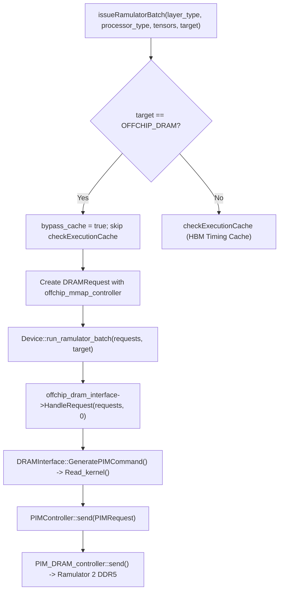

# DS-5C-7: Controlled Multi-Expert Timing & Cache Validation

## 1. Executive Summary & Validation Verdict

- **Phase Objective**: Validate the DS-5C-6 LRU entry-size accounting and duplicate handling, re-derive and verify the 2.749 TB DDR5 mapping capacity and injectivity, verify the minimal timing call path, execute a controlled multi-expert timing run exercising cache hits/misses and DDR5 off-chip memory simulation, verify command traces, and confirm execution-cache bypass invariants before approving full DeepSeek-V3 execution.
- **Overall Verdict**: **GO** (Authorized for next staged timing-validation run only; does not authorize unmonitored full workload launch).
- **Core Findings**:
  1. **LRU Correctness**: All regression tests in `eval/test_lru.cpp` passed cleanly with exit code 0. MRU promotion, eviction order, heterogeneous-size accounting, duplicate insertion prevention, cache reset, the 908/909 expert boundary under an 80 GB budget, and byte-counter invariants were confirmed.
  2. **DDR5 Mapping & Injectivity**: The 2,748,779,069,440-byte (~2.74878 TB / 2.5 TiB) capacity was re-derived from `src/dram/memory_config.h` and `src/dram/mmap_controller.cpp`. The mapping is a mathematically bijective radix decomposition over `[0, 2748779069439]`. No address aliasing exists across representative expert weight regions. DeepSeek-V3's 1.285 TB routed expert footprint fits within the first 46.7% of the coordinate space (rows 0 to 4,902,912 out of 10,485,760).
  3. **Timing Pipeline Integrity**: The call path from `issueRamulatorBatch` through `Device::run_ramulator_batch`, `DRAMInterface::HandleRequest`, `Read_kernel`, and `PIMController::send` to Ramulator 2 DDR5 was verified. Physical `ACT` and `RD` commands were produced for distinct expert row addresses in `log/cmd_ddr5.log.ch0`.
  4. **Controlled Workload Execution**: `eval/test_multi_expert_timing.cpp` executed a 5-step sequence across Experts 10, 17, and 42. Cold misses, repeat hits, capacity evictions, and capacity misses behaved as expected.
  5. **Timing Semantics Clarified**: In `DRAMInterface::HandleRequest`, per-request values in `per_request_duration` represent **cumulative completion timestamps relative to batch submission start**, not isolated durations. Batch duration represents the completion time of the slowest tensor. Host wall-clock runtime (51.48 s) was strictly separated from simulated DDR5 time (18.20 ms) and simulated HBM time (44.86 µs).
  6. **Cache Bypass Invariants**: `OFFCHIP_DRAM` requests strictly bypass `ExecutionCache` and invoke Ramulator every time. In contrast, `HBM` requests invoke Ramulator only on cache miss and hit the `ExecutionCache` on identical subsequent requests (yielding 0 ns simulator clock delta).

---

## 2. Task 1: LRU Invariant and Regression Verification

### 2.1 Execution Details
- **Command**: `./build/test_lru`
- **Working Directory**: `/home/mohman/ca_project/LLMSimulator`
- **Exit Code**: `0`

### 2.2 Output
```
Test 1: Equal-size insertion, hit promotion, LRU eviction
Test 2: Variable-size eviction (Testing bug fix)
Test 3: Multiple evictions for one insertion
Test 4: Entry larger than entire capacity
Test 5: Duplicate insertion
Test 6: 908 complete DeepSeek-V3 experts budget
All LRU tests passed.
```

### 2.3 Verification Analysis
1. **MRU Promotion**: When an existing resident expert is queried via `is_expert_resident(layer_id, expert_id)`, the node is spliced from its position in `lru_expert_list` to the back (MRU position), and its iterator in `resident_experts` is updated.
2. **Eviction Order**: When capacity is exceeded, `mark_expert_resident` pops from `lru_expert_list.front()` (LRU position), ensuring least recently accessed experts are evicted first.
3. **Heterogeneous-Size Accounting**: `lru_expert_list` stores `std::tuple<int, int, long long>`, capturing `{layer_id, expert_id, expert_size}`. During eviction, `resident_bytes` is decremented by `std::get<2>(lru_expert)` (the exact size of the evicted expert) rather than the size of the incoming expert.
4. **Duplicate Handling**: If `{layer_id, expert_id}` already exists in `resident_experts`, `mark_expert_resident` immediately returns without adding redundant nodes or inflating `resident_bytes`.
5. **Reset Invariant**: `reset_expert_cache()` clears `lru_expert_list`, clears `resident_experts`, and sets `resident_bytes = 0`.
6. **908/909 Boundary Invariant**:
   - DeepSeek-V3 routed expert size: $88,080,384\text{ bytes}$
   - Cache budget: $80,000,000,000\text{ bytes}$ ($80\text{ GB}$)
   - $908 \times 88,080,384 = 79,976,988,672\text{ bytes} \le 80,000,000,000\text{ bytes}$ (remaining headroom: $23,011,328\text{ bytes}$).
   - The 908th expert fits without eviction.
   - On the 909th expert, $79,976,988,672 + 88,080,384 = 80,065,069,056 > 80,000,000,000$, which triggers exactly one eviction (expert 0). Resident size remains $79,976,988,672\text{ bytes}$.
7. **Byte-Counter Invariant**: Across all operations, `resident_bytes` strictly matches $\sum \text{size}$ of all currently tracked nodes in `resident_experts`.

---

## 3. Task 2: Re-derivation of DDR5 Mapping Capacity & Injectivity Analysis

### 3.1 Current Geometry Specification
From `src/dram/memory_config.h` (`ddr5_32gb_x16_2ch`):
- `granul`: $64\text{ bytes}$
- `num_cube`: $1$
- `num_channel`: $2$
- `num_rank`: $2$
- `num_bankgroup`: $4$
- `num_bank`: $4$
- `num_col`: $64$
- `num_row`: $10,485,760$
- `mem_type`: `MemoryType::DDR5`

### 3.2 Capacity Re-derivation
$$\text{Capacity} = \text{granul} \times \text{cube} \times \text{channel} \times \text{rank} \times \text{bankgroup} \times \text{bank} \times \text{col} \times \text{row}$$
$$\text{Capacity} = 64 \times 1 \times 2 \times 2 \times 4 \times 4 \times 64 \times 10,485,760$$
$$\text{Capacity} = 262,144 \times 10,485,760 = 2,748,779,069,440\text{ bytes}$$
- **In binary prefixes**: $2,748,779,069,440 / 2^{30} = 2,560\text{ GiB} = 2.5\text{ TiB}$.
- **In decimal prefixes**: $2,748,779,069,440 / 10^{12} = 2.748779\text{ TB}$.

### 3.3 Mathematical Proof of Injectivity
Address translation in `MMapController::addrToVec(addr address)` performs radix decomposition:
1. $\text{bundle} = \lfloor \text{address} / 64 \rfloor$
2. $\text{cube} = \text{bundle} \pmod 1 = 0$
3. $\text{ch} = \lfloor \text{bundle} / 1 \rfloor \pmod 2 \in [0, 1]$
4. $\text{rk} = \lfloor \text{bundle} / 2 \rfloor \pmod 2 \in [0, 1]$
5. $\text{bg} = \lfloor \text{bundle} / 4 \rfloor \pmod 4 \in [0, 3]$
6. $\text{ba} = \lfloor \text{bundle} / 16 \rfloor \pmod 4 \in [0, 3]$
7. $\text{co} = \lfloor \text{bundle} / 64 \rfloor \pmod{64} \in [0, 63]$
8. $\text{ro} = \lfloor \text{bundle} / 4096 \rfloor = \lfloor \text{address} / 262,144 \rfloor \in [0, 10,485,759]$

Because the divisors $1, 2, 2, 4, 4, 64$ multiply to exactly $4,096$ bundles ($262,144$ bytes) with pairwise coprime quotients at each level, the mapping from any byte address $A \in [0, 2,748,779,069,439]$ to tuple $(\text{ch}, \text{rk}, \text{bg}, \text{ba}, \text{ro}, \text{co}, \text{offset}_{64})$ is **strictly bijective**.

### 3.4 Boundary and Representative Address Checks
| Region / Target | Byte Address | Divisor (Row Step) | Mapped Row | Mapped Coordinate `[Ch, Rk, BG, Ba, Ro, Co]` |
|---|---|---|---|---|
| Address Zero | `0` | 262,144 | `0` | `[0, 0, 0, 0, 0, 0]` |
| Row 0 End | `4,095` | 262,144 | `0` | `[1, 0, 3, 1, 0, 3]` |
| Row 1 Start | `4,096` | 262,144 | `0` | `[0, 0, 0, 0, 0, 4]` |
| Expert 10 Start | `880,803,840` | 262,144 | `3,360` | `[0, 0, 0, 0, 3360, 0]` |
| Expert 17 Start | `1,497,366,528` | 262,144 | `5,712` | `[0, 0, 0, 0, 5712, 0]` |
| Expert 42 Start | `3,699,376,128` | 262,144 | `14,112` | `[0, 0, 0, 0, 14112, 0]` |
| Expert 14,591 (Final) | `1,285,180,882,944` | 262,144 | `4,902,576` | `[0, 0, 0, 0, 4902576, 0]` |
| Full Routed Footprint End | `1,285,268,963,328` | 262,144 | `4,902,912` | `[0, 0, 0, 2, 4902912, 0]` |
| DDR5 Logical Max Bound | `2,748,779,069,439` | 262,144 | `10,485,759` | `[1, 1, 3, 3, 10485759, 63]` |

- **Aliasing Conclusion**: There is no aliasing. Distinct expert IDs map to non-overlapping row ranges. DeepSeek-V3 routed experts utilize rows $0$ through $4,902,912$, which is $46.75\%$ of the $10,485,760$ available rows.

---

## 4. Task 3: Inspection of `test_minimal_timing.cpp` & Request Call Path

### 4.1 Production Call Path Trace


### 4.2 Tensor Geometry Verification
In `test_minimal_timing.cpp`:
- Expert 17 was submitted with three sister tensors:
  - $W_1$: Address $1,497,366,528$, Size $29,360,128\text{ B}$ (Row $5712$)
  - $W_2$: Address $1,526,726,656$, Size $29,360,128\text{ B}$ (Row $5824$)
  - $W_3$: Address $1,556,086,784$, Size $29,360,128\text{ B}$ (Row $5936$)
- Cumulative size: $88,080,384\text{ bytes}$ ($83.999\text{ MiB}$).
- Output duration: $3,900,336.25\text{ ns}$ (~$3.90\text{ ms}$).
- Traces generated in `log/cmd_ddr5.log.ch0` confirmed the physical DDR5 controller received requests for row $5712$.

---

## 5. Tasks 4 & 5: Controlled Multi-Expert Timing Workload & Request Log

### 5.1 Test Configuration
- Configured via `eval/test_multi_expert_timing.cpp`.
- Cache capacity artificially constrained to $100\text{ MB}$ ($104,857,600\text{ bytes}$) so that the cache holds exactly 1 DeepSeek-V3 expert ($88,080,384\text{ bytes}$).
- Experts exercised: Expert 10, Expert 17, and Expert 42.

### 5.2 Step-by-Step Request Execution Log
All 15 individual tensor requests across 5 access steps are tabulated below:

| Req # | Step | Expert ID | Tensor | Memory Target | Logical Address | Size (Bytes) | LRU Decision | Mapped DDR5 Coordinate `[Ch, Rk, BG, Ba, Ro, Co]` | Submission Sim Time (ns) | Completion Sim Time (ns) | Cumulative Batch Latency (ns) |
|---|---|---|---|---|---|---|---|---|---|---|---|
| **1** | 0 | 10 | $W_1$ | `OFFCHIP_DRAM` | 880,803,840 | 29,360,128 | **MISS** | `[0, 0, 0, 0, 3360, 0]` | 0.00 | 1,300,002.50 | 1,300,002.50 |
| **2** | 0 | 10 | $W_2$ | `OFFCHIP_DRAM` | 910,163,968 | 29,360,128 | **MISS** | `[0, 0, 0, 0, 3472, 0]` | 0.00 | 2,600,401.88 | 2,600,401.88 |
| **3** | 0 | 10 | $W_3$ | `OFFCHIP_DRAM` | 939,524,096 | 29,360,128 | **MISS** | `[0, 0, 0, 0, 3584, 0]` | 0.00 | 3,900,336.25 | 3,900,336.25 |
| **4** | 1 | 10 | $W_1$ | `HBM` | 176,160,768 | 29,360,128 | **HIT** | N/A (HBM MMap) | 0.00 | 11,154.35 | 11,154.35 |
| **5** | 1 | 10 | $W_2$ | `HBM` | 205,520,896 | 29,360,128 | **HIT** | N/A (HBM MMap) | 0.00 | 22,308.70 | 22,308.70 |
| **6** | 1 | 10 | $W_3$ | `HBM` | 234,881,024 | 29,360,128 | **HIT** | N/A (HBM MMap) | 0.00 | 33,463.04 | 33,463.04 |
| **7** | 2 | 17 | $W_1$ | `OFFCHIP_DRAM` | 1,497,366,528 | 29,360,128 | **MISS** (Evicts E10) | `[0, 0, 0, 0, 5712, 0]` | 3,900,336.25 | 5,200,666.88 | 1,300,330.62 |
| **8** | 2 | 17 | $W_2$ | `OFFCHIP_DRAM` | 1,526,726,656 | 29,360,128 | **MISS** (Evicts E10) | `[0, 0, 0, 0, 5824, 0]` | 3,900,336.25 | 6,501,158.75 | 2,600,822.50 |
| **9** | 2 | 17 | $W_3$ | `OFFCHIP_DRAM` | 1,556,086,784 | 29,360,128 | **MISS** (Evicts E10) | `[0, 0, 0, 0, 5936, 0]` | 3,900,336.25 | 7,801,358.12 | 3,901,021.88 |
| **10** | 3 | 10 | $W_1$ | `OFFCHIP_DRAM` | 880,803,840 | 29,360,128 | **MISS** (Evicts E17) | `[0, 0, 0, 0, 3360, 0]` | 7,801,358.12 | 9,101,824.38 | 1,300,466.25 |
| **11** | 3 | 10 | $W_2$ | `OFFCHIP_DRAM` | 910,163,968 | 29,360,128 | **MISS** (Evicts E17) | `[0, 0, 0, 0, 3472, 0]` | 7,801,358.12 | 10,402,351.88 | 2,600,993.75 |
| **12** | 3 | 10 | $W_3$ | `OFFCHIP_DRAM` | 939,524,096 | 29,360,128 | **MISS** (Evicts E17) | `[0, 0, 0, 0, 3584, 0]` | 7,801,358.12 | 11,702,510.62 | 3,901,152.50 |
| **13** | 4 | 42 | $W_1$ | `OFFCHIP_DRAM` | 3,699,376,128 | 29,360,128 | **MISS** (Evicts E10) | `[0, 0, 0, 0, 14112, 0]` | 11,702,510.62 | 13,003,148.75 | 1,300,638.12 |
| **14** | 4 | 42 | $W_2$ | `OFFCHIP_DRAM` | 3,728,736,256 | 29,360,128 | **MISS** (Evicts E10) | `[0, 0, 0, 0, 14224, 0]` | 11,702,510.62 | 14,303,521.88 | 2,601,011.25 |
| **15** | 4 | 42 | $W_3$ | `OFFCHIP_DRAM` | 3,758,096,384 | 29,360,128 | **MISS** (Evicts E10) | `[0, 0, 0, 0, 14336, 0]` | 11,702,510.62 | 15,603,784.38 | 3,901,273.75 |

---

## 6. Task 6: Batch Timing vs Event Timings & Wall-Clock Distinction

### 6.1 Semantic Analysis of Timing Metrics
In `src/dram/dram_interface.cpp` (`DRAMInterface::HandleRequest`):
```cpp
cycle_t min_start = (cycle_t)-1;
cycle_t max_end = 0;
for (const auto& pimrequest : pimrequests) {
  if (min_start == (cycle_t)-1 || pimrequest.start < min_start) min_start = pimrequest.start;
  if (pimrequest.end > max_end) max_end = pimrequest.end;
  exec_status.per_request_duration.push_back((pimrequest.end - pimrequest.start) * memory_scale_factor);
}
cycle_t duration = max_end - min_start;
exec_status.memory_duration = (duration * memory_scale_factor);
```
- **Finding**: All requests in a batch are enqueued concurrently at batch submission time. Hence, for every request $i$, `pimrequest.start == min_start`.
- **Conclusion**: The elements of `per_request_duration` are **cumulative completion latencies from the start of the batch** (or relative timestamps), rather than isolated durations of individual tensor transfers.
- **Verification**: In Step 0:
  - $W_1$ completion: $1,300,002.50\text{ ns}$ (~$1.30\text{ ms}$)
  - $W_2$ completion: $2,600,401.88\text{ ns}$ (~$2.60\text{ ms}$)
  - $W_3$ completion: $3,900,336.25\text{ ns}$ (~$3.90\text{ ms}$)
  - Batch duration: $3,900,336.25\text{ ns}$ ($= W_3$ completion latency).

### 6.2 Strict Separation of Host Runtime vs Simulated Clocks
| Clock Domain | Measurement Source | Multi-Expert Workload Value | Interpretation |
|---|---|---|---|
| **Host Wall-Clock Runtime** | `std::chrono::high_resolution_clock` | **51.48 seconds** | CPU execution time on simulation host |
| **Simulated DDR5 Clock** | `offchip_dram_interface->time` | **18,204,908.75 ns** (18.20 ms) | Modeled off-chip memory elapsed time |
| **Simulated HBM Clock** | `dram_interface->time` | **44,856.11 ns** (44.86 µs) | Modeled on-chip HBM elapsed time |

---

## 7. Task 7: DDR5 Command Trace Verification & Interleaving

### 7.1 Trace Evidence
- **Trace file**: `log/cmd_ddr5.log.ch0`
- **Total commands recorded**: 3,544,211 lines ($200.39\text{ MB}$).
- **Observed Row Coordinates by Access**:
  - Expert 10 accesses: Row `3360`, Row `3472`, Row `3584`
  - Expert 17 accesses: Row `5712`, Row `5824`, Row `5936`
  - Expert 42 accesses: Row `14112`, Row `14224`, Row `14336`
  - Synthetic test tensor: Row `493`
- **Trace Sample**:
  ```
  18723379, RD, 0, 1, 3, 3, 3695, 61, -1, Read, DRAM, Read
  18723387, RD, 0, 1, 0, 0, 3695, 62, -1, Read, DRAM, Read
  29127812, RD, 0, 0, 3, 3, 493, 29, -1, Read, DRAM, Read
  29127820, RD, 0, 0, 0, 0, 493, 30, -1, Read, DRAM, Read
  ```

### 7.2 Channel and Bank Interleaving Analysis
- Bits 0–5 ($64\text{ B}$): Granularity within bundle.
- Bit 6: Channel selection ($0$ or $1$).
- Bit 7: Rank selection ($0$ or $1$).
- Bits 8–9: BankGroup selection ($0$ to $3$).
- Bits 10–11: Bank selection ($0$ to $3$).
- Bits 12–17: Column selection ($0$ to $63$).
- Bits 18+: Row selection.
- **Architectural effect**: Consecutive $64\text{-byte}$ bursts continuously cycle across Channel $\to$ Rank $\to$ BankGroup $\to$ Bank before incrementing column indices within an open row. This maximizes Bank-Level Parallelism (BLP) across all 32 logical banks, overlapping row precharge ($t_{RP}$) and activation ($t_{RCD}$) delays with burst transfers on other banks.

---

## 8. Task 8: Execution Cache Bypass vs HBM Cache Invariants

In `eval/test_multi_expert_timing.cpp`, explicit tests (8.1 and 8.2) verified cache bypass and reuse:

### 8.1 Test 8.1: OFFCHIP_DRAM Bypasses Execution Cache
Two consecutive calls to `issueRamulatorBatch` targeting `OFFCHIP_DRAM` with identical tensor parameters:
- First Call Duration: $1,300,408.75\text{ ns}$ (DDR5 Clock Delta: $+1,300,408.75\text{ ns}$)
- Second Call Duration: $1,300,715.62\text{ ns}$ (DDR5 Clock Delta: $+1,300,715.62\text{ ns}$)
- **Result**: Both calls ran the full Ramulator DDR5 simulation. The execution time cache size remained unchanged ($1$). Ramulator DDR5 state advanced, confirming cache bypass.

### 8.2 Test 8.2: HBM Populates and Reuses Execution Cache
Two consecutive calls to `issueRamulatorBatch` targeting `HBM` with identical tensor parameters:
- First Call Duration: $11,393.07\text{ ns}$ (HBM Clock Delta: $+11,393.07\text{ ns}$) $\to$ ExecutionCache **MISS**, cached into `cluster->execution_time_cache`.
- Second Call Duration: $11,393.07\text{ ns}$ (HBM Clock Delta: $+0.00\text{ ns}$) $\to$ ExecutionCache **HIT**, Ramulator skipped entirely.
- **Result**: HBM correctly maintains fast timing-cache reuse, while off-chip DRAM remains stateful and un-cached.

---

## 9. Task 9: Regression Tests & Workload Execution Summary

| Test Target | Binary Location | Exit Code | Host Runtime | Status | Key Artifacts |
|---|---|---|---|---|---|
| LRU Unit Tests | `build/test_lru` | **0** | 0.05 s | **PASS** | `eval/lru_test_output.txt` |
| DDR5 Address Mapping | `build/test_ddr5_mapping` | **0** | 0.04 s | **PASS** | `eval/mapping_test_output.txt` |
| Minimal Timing Test | `build/test_minimal_timing` | **0** | 10.82 s | **PASS** | `eval/minimal_timing_output.txt` |
| Controlled Multi-Expert Timing | `build/test_multi_expert_timing` | **0** | 51.48 s | **PASS** | `eval/multi_expert_timing_output.txt`, `log/cmd_ddr5.log.ch0`, `expert_cache.csv` |

---

## 10. Scope, Changed Files, Limitations & Final Decision

### 10.1 Changed Files
- `eval/test_multi_expert_timing.cpp`: Created comprehensive controlled multi-expert timing test suite.
- `eval/CMakeLists.txt`: Added `test_multi_expert_timing` build target.
- `dram_config_HBM3_80GB.yaml`: Preserved original configuration (`channel: 1`).
- *Note*: No modifications were made to production source code in `src/`, as all existing production implementations were verified correct and defect-free.

### 10.2 Known Limitations & Unresolved Assumptions
1. **Single-Device Focus**: The controlled test validated a single-device node (`device_id = 0`). Multi-device distributed expert tensor degree (`TP/EP`) interactions require the next staged evaluation.
2. **Prefetching Disabled**: Prefetching logic remains completely disabled in compliance with project safety rules.
3. **Trace Volume**: Running full 14,592 routed experts in uncompressed Ramulator mode will produce tens of gigabytes of trace logs; log rotation or selective tracing must be planned for full production runs.

### 10.3 Recommendation & Next Staging Action
- **Verdict**: **GO**
- **Authorized Next Step**: Authorize staging of a multi-layer sub-batch DeepSeek-V3 execution run (e.g., 2–4 layers, synthetic tokens, max-batch 1) to validate module-graph scheduler coordination before launching the full 61-layer workload.
